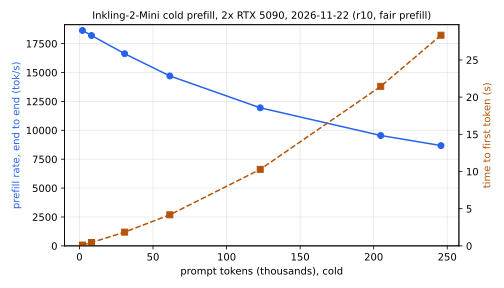

# Inkling-2-Mini on two RTX 5090s

[Inkling-2-Mini](https://huggingface.co/thinkingmachines/Inkling-2-Mini) (Thinking Machines, 26B total / 3.4B active
looped MoE, text and image in) served with vLLM on two RTX 5090 (32 GB, PCIe, no NVLink): both cards as one model
(tensor parallel 2), the checkpoint's own DSpark drafter, and the full 262,144-token context. A single 5090 cannot hold
the drafter and a useful context; two give a 699,885-token KV pool with an fp8 cache.

vLLM's day-0 image for this model does not run its drafter on consumer Blackwell (sm_120). The overlay in
[`docker/`](docker/README.md) makes it run and adds three speedups. Two products in the decode step move off cuBLAS
onto bitwise-identical Triton kernels. A scheduler budget lets long prefills interleave with decoding streams.
Sampling is sharded across the two cards. Everything else is the official checkpoint and vLLM's recipe flags.

## Numbers

Measured 2026-11-21 on one boot of the served configuration (`scripts/serve.sh`, image `sm120-r8` from
`scripts/build-image.sh`), stock power limits. **Decode rate** is one stream's output tokens per second from its first
to its last token, from the server's per-chunk token counts. **Aggregate** is the total decode rate of the streams
running together. Time to first token (TTFT) is separate.


Blue: code with a 2K append, averaged over the 1K / 32K / 64K cached depths. Brown: Spec-Bench. Grey dashed: Spec-Bench
without the drafter (an earlier image with NCCL all-reduce, [docs/CONFIGURATION.md](docs/CONFIGURATION.md)). Drawn by
`bench/plot.py`.

**Spec-Bench** (120-prompt stratified subset per concurrency, temperature 0, 256 forced output tokens, `vllm bench serve`;
[results](bench/results/20261121T222403Z-inkling2-specbench-served-r8), `bench/specbench.sh`,
`bench/specbench_summary.py`):

| Streams | Decode rate per stream (median) | Aggregate | TTFT (median) | Drafter acceptance length |
| ---: | ---: | ---: | ---: | ---: |
| 1 | 372 tok/s | 408 tok/s | 33 ms | 2.97 |
| 4 | 237 tok/s | 1,004 tok/s | 55 ms | 3.01 |
| 8 | 181 tok/s | 1,531 tok/s | 70 ms | 2.97 |

Here the aggregate is the stream count times the mean request decode rate (the benchmark keeps every stream busy).

**Code at depth** (a shared code context cached at 1K / 32K / 64K tokens, a fresh tool-output append and a HumanEval task
per stream, 400 forced output tokens, temperature 0, no thinking; the cached context is verified as a cache hit on every
stream; [results](bench/results/20261121T222641Z-inkling2-code-r8), `bench/headline_inkling.py code`). Aggregate = tokens
decoded by all streams during the window in which every stream is decoding, divided by its length:

| Cached context | Append | 1 stream | 4 streams: per stream / aggregate | 8 streams: per stream / aggregate |
| ---: | ---: | ---: | ---: | ---: |
| 1K | 2K | 574 tok/s | 267 / 1,131 tok/s | 196 / 1,698 tok/s |
| 32K | 2K | 547 tok/s | 265 / 1,144 tok/s | 184 / 1,643 tok/s |
| 64K | 2K | 486 tok/s | 234 / 1,015 tok/s | 181 / 1,658 tok/s |
| 1K | 8K | 376 tok/s | 213 / 980 tok/s | 140 / 1,830 tok/s |
| 32K | 8K | 347 tok/s | 184 / 1,003 tok/s | 125 / 1,609 tok/s |
| 64K | 8K | 462 tok/s | 175 / 911 tok/s | 109 / 1,448 tok/s |

One stream's rate varies with the task and the appended code: each cell is one request, and the drafter accepts more
on predictable code. Over three more boots the six one-stream cells ranged from 381 to 628 tok/s, mean 524
([paired results](bench/results/20261121T224848Z-inkling2-code-paired-r5-r8)). Median TTFT is 0.14–0.80 s for one
stream. With eight streams and 8K appends it reaches up to 6.6 s, because the prefills queue together behind the
decoding streams.

**Cold prefill** (fresh salted prompts with no cached prefix, verified, one at a time; end to end: prompt tokens divided
by the client's TTFT; [results](bench/results/20261121T222811Z-inkling2-prefill-r8a), `bench/headline_inkling.py prefill`):

| Prompt tokens | 2,048 | 8,191 | 30,715 | 61,435 | 122,878 | 204,799 | 245,757 |
| --- | ---: | ---: | ---: | ---: | ---: | ---: | ---: |
| TTFT | 0.12 s | 0.45 s | 1.85 s | 4.19 s | 10.4 s | 21.7 s | 28.7 s |
| Prefill rate | 17,527 | 18,110 | 16,581 | 14,657 | 11,855 | 9,439 | 8,558 tok/s |



A second pass on the same boot is within 1 % on every cell ([results](bench/results/20261121T222926Z-inkling2-prefill-r8b)).

**Quality** (same boot; [results](bench/results/20261121T222320Z-inkling2-quality-r8)):

| Benchmark | Setting | Score |
| --- | --- | ---: |
| tool-eval-bench 2.1.0 | 69 scenarios, temperature 1.0 (the checkpoint's default), 8 in parallel | 85 / 100 |
| GSM8K (lm-eval 0.4.12) | 5-shot, first 200 problems, temperature 0, `reasoning_effort` none | 53.5 % flexible, 32.0 % strict |

## Served configuration

```bash
bash scripts/build-image.sh
MODEL_DIR=/path/to/Inkling-2-Mini bash scripts/serve.sh     # OpenAI-compatible API on :8000, model "inkling-2-mini"
```

| Setting | Value |
| --- | --- |
| Checkpoint | `thinkingmachines/Inkling-2-Mini`, official NVFP4/MXFP8 (19.5 GB) + DSpark drafter `mtp.safetensors` (636 MB) |
| Engine | `vllm/vllm-openai:inkling-2-mini` (vLLM `0.1.dev25855+g7cb5dae22`, pinned by digest) + the `docker/` overlay (`inkling2-rtx5090:sm120-r8`) |
| Parallelism | tensor parallel 2; all-reduce = FlashInfer PCIe IPC (`VLLM_ALLREDUCE_USE_FLASHINFER_PCIE_IPC=1`), NCCL fallback; vLLM's custom all-reduce off |
| Drafter | DSpark, 7 draft tokens per step (the only value the checkpoint accepts); its KV cache in bf16 |
| Context | 262,144 tokens; KV pool 699,885 tokens (`--kv-cache-dtype fp8`, unit-scale E4M3), `--gpu-memory-utilization 0.92`, 16 sequences |
| Scheduler | `VLLM_DECODE_STEP_BUDGET=1024` (overlay): at most 1,024 tokens per step while a request is decoding; 2,048 otherwise |
| Sampling | `--enable-batch-sharded-sampling` (overlay): each request sampled on one card from both cards' vocabulary shards |
| API | `--reasoning-parser inkling --tool-call-parser inkling --enable-auto-tool-choice`; `reasoning_effort` none … max |
| Warmup | FlashInfer autotune off (`--kernel-config`) |
| Usage | `--enable-prompt-tokens-details` (cached prompt tokens in `usage`) |

## What the stack is

- **Model**: 24 decoder layers whose middle 12 run three times with shared weights (48 layer applications per token),
  128-expert MoE with 8 active, mostly sliding-window attention with one full-attention layer in six. Experts are NVFP4
  (layers 0–19) and MXFP8 (layers 20–23).
- **Drafter**: DSpark, a 3-layer block drafter that reads target hidden states and proposes 7 tokens per step.
- **Overlay**: the day-0 image's compiled core library has no sm_120 code. Inkling's own kernels (Triton/Gluon) run
  on the 5090. The overlay replaces the two compiled kernels the drafter and the tensor-parallel embedding reach. It
  also adds the decode, scheduler and sampling changes above. Details and the guard checks:
  [`docker/README.md`](docker/README.md).

Alternatives that were measured (no drafter, one model copy per card, bf16 KV, scheduler and sampling settings) and the
output checks are in [`docs/CONFIGURATION.md`](docs/CONFIGURATION.md).
