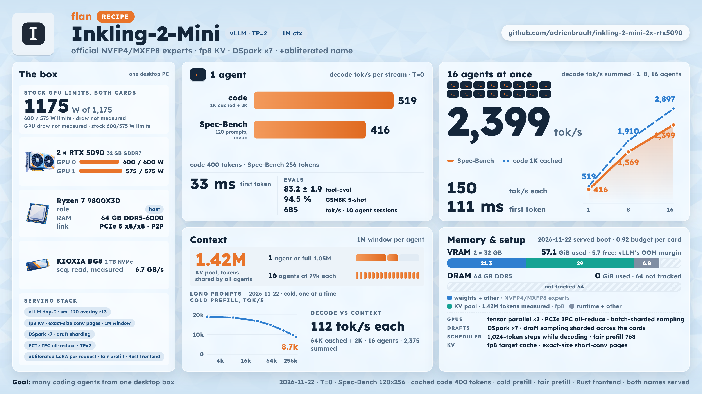
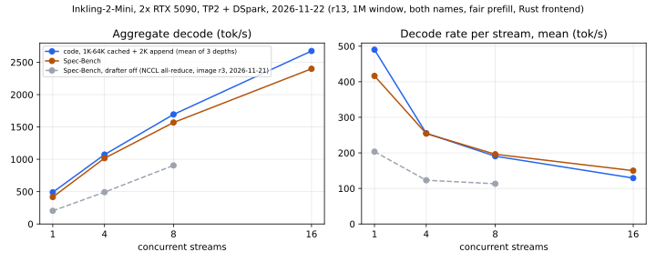

# Inkling-2-Mini on two RTX 5090s



Serving configuration, vLLM overlay and launch scripts for [Inkling-2-Mini](https://huggingface.co/thinkingmachines/Inkling-2-Mini) on x86-64 Linux with two RTX 5090s (32 GB each), Docker and the NVIDIA Container Toolkit. The recipe is for coding agents sharing one server, with long prompts that mostly hit the prefix cache.

Spec-Bench on r13, 2026-11-22: **416 tok/s** on one stream and **2,399 tok/s summed** over 16 (150 per stream, 111 ms median to the first token). [Raw run](bench/results/20261122T192436Z-inkling2-specbench-served-r13)

[Quick start](#quick-start)

*Card: measurements from r13 with a 1M window and both names, 2026-11-22. [Spec-Bench](bench/results/20261122T192436Z-inkling2-specbench-served-r13), [cold prefill](bench/results/20261122T192938Z-inkling2-prefill-r13-a), [KV capacity and memory](bench/results/20261122T200911Z-inkling2-kv-capacity-r13).*

- **Model**: [Inkling-2-Mini](https://huggingface.co/thinkingmachines/Inkling-2-Mini) (Thinking Machines; 26B total, 3.4B active; text and images in), the official checkpoint and its own DSpark drafter (7 draft tokens).
- **Engine**: vLLM's Inkling day-0 image plus a small overlay ([`docker/`](docker/README.md)) that makes it run on the RTX 5090 and speeds up serving. The day-0 image needs the overlay to serve this configuration on SM120. See [output checks](#output-checks-and-caveats) for the measured comparisons.
- **Window and KV pool**: up to 1,048,576 tokens per request; the fp8 KV pool holds about 1.42M tokens of context at once, measured on `sm120-r13` (the served `sm120-r14` has 3.5 % more KV blocks, [`r14-ab`](bench/results/20261122T203506Z-inkling2-r14-ab); capacity not re-measured), shared by 16 sequences, tensor parallel over both cards. A request near 1M fits one at a time and slows the others while it runs ([1M window](#1m-window)).
- **Model names**: `inkling-2-mini`, plus `inkling-2-mini-ablit` when the launcher loads the pinned rank-2 LoRA. Choose the name per request ([abliterated name](#abliterated-name)).
- **Enabled**: images, reasoning, tool calls.

The reported measurements were taken on one machine on the dates given, with raw results under [`bench/results/`](bench/results/).

## Numbers

The headline measurements are from 2026-11-22 on r13 ([recorded recipe](docs/REPRODUCE.md#measurement-boot), commit `2aa8760`), with a 1M window, both names, fair prefill, Rust frontend and stock power limits. They are for `inkling-2-mini`. The launcher now builds r14, which computes DSpark RoPE in-kernel. The [r14 A/B](bench/results/20261122T203506Z-inkling2-r14-ab/summary.json) matched 11 lone-request outputs per sampling mode and the one-stream draft counters, with 3.5 % more KV blocks at 1M. The headline suite and live KV capacity were not re-measured on r14. Decode rate is one stream's output tokens per second from its first to its last token, averaged over the requests (the median is in the tables below); the aggregate is the sum over the streams running together ([how the numbers are measured](#how-the-numbers-are-measured)).



Blue: code with a 2K append, averaged over the 1K / 32K / 64K cached depths. Brown: Spec-Bench. Grey dashed: Spec-Bench without the drafter, on an earlier image ([`docs/CONFIGURATION.md`](docs/CONFIGURATION.md)).

- **1 agent**: 416 tok/s on Spec-Bench with a median first token at 33 ms. Cached code at 1K depth and a 2K append reached 519 tok/s.
- **16 agents**: 2,399 tok/s summed on Spec-Bench (150 each, first token 111 ms); 2,897 on cached code (146 each). At 64K cached context: 112 each, 2,375 summed.
- **Agent sessions**: 685 tok/s summed with 10 coding-agent sessions replayed at once (prompts of about 39K–202K tokens, p10–p90, mostly cached), first token 0.22 s median and 0.82 s p90; 524 tok/s with 6 sessions, first token 0.16 s median.
- **Newcomers**: a short request arriving behind a cold 196K-token prompt gets its first token in 0.54 s, a 16K one in 6.7 s (fair prefill).


- **Cold prefill**: 19,012 tok/s at 2K prompt tokens, 14,830 at 61K and 8,724 at 246K (28.2 s to the first token). The [historical r10 1M run](#1m-window) took about 7 min.
- **Quality**: tool-eval 83.2 ± 1.9 over 4 trials of 69 scenarios; GSM8K 94.5 % (5-shot, 200 problems).

- **KV pool**: 8 agents with 96K-token prompts decoding together used 66 % of it, nothing preempted: about 1.42M tokens of context fit at once. With 12 such agents, 11 ran together and the 12th waited for room.

Sources: KV pool [`kv-capacity-r13`](bench/results/20261122T200911Z-inkling2-kv-capacity-r13), Spec-Bench [`specbench-served-r13`](bench/results/20261122T192436Z-inkling2-specbench-served-r13), code [`code-r13`](bench/results/20261122T192732Z-inkling2-code-r13), prefill [`prefill-r13-a`](bench/results/20261122T192938Z-inkling2-prefill-r13-a), agent sessions [`pi-r13`](bench/results/20261122T192343Z-inkling2-pi-r13), newcomers [`newcomer-r13`](bench/results/20261122T200911Z-inkling2-newcomer-r13), tool-eval and GSM8K [`quality-r13`](bench/results/20261122T192343Z-inkling2-quality-r13), memory [`kv-capacity-r13`](bench/results/20261122T200911Z-inkling2-kv-capacity-r13). Full tables: [details](#all-numbers).

## Quick start

Use x86-64 Linux, two RTX 5090s (32 GB each), Git, Bash, Python 3 with `venv`, curl, and a **local** Docker Engine with the NVIDIA Container Toolkit. The day-0 image needs a CUDA 13 driver. The archived measurements ran on Ubuntu 24.04 (kernel 7.0), NVIDIA driver 610.57.04, Docker 29.1.3 and NVIDIA Container Toolkit 1.20.0; older CUDA 13 drivers (R580 and later) are untested.

Allow about 20.1 GB for the checkpoint and bundled drafter (19.5 GB + 636 MB), plus space on the Docker and cache volumes. The image and Triton cache sizes were not recorded. The first build needs Docker Hub access. Package and model downloads need access to PyPI and the Hugging Face Hub.

1. Follow NVIDIA's [Container Toolkit installation and Docker setup](https://docs.nvidia.com/datacenter/cloud-native/container-toolkit/latest/install-guide.html). For a standard rootful Docker Engine, the runtime setup is:

   ```bash
   sudo nvidia-ctk runtime configure --runtime=docker
   sudo systemctl restart docker
   nvidia-smi -L
   ```

   Use device indices from `nvidia-smi -L` in `GPUS` below. Your account must be able to run `docker` against the local daemon so the model and cache bind mounts resolve on this host.

2. Clone and fetch the checkpoint in a venv. Every archived result was measured on the revision below.

   ```bash
   git clone https://github.com/adrienbrault/inkling-2-mini-2x-rtx5090.git
   cd inkling-2-mini-2x-rtx5090
   python3 -m venv .venv
   . .venv/bin/activate
   python -m pip install huggingface_hub
   export MODEL_DIR="$PWD/../Inkling-2-Mini"
   hf download thinkingmachines/Inkling-2-Mini --revision ed40e7da625f594fc9c4990f5f66be24873c22d7 --local-dir "$MODEL_DIR"
   ```

   If a download requires access, sign in on its Hub page and accept or request any access shown there, then run `hf auth login` in the venv and retry. Check the [checkpoint](https://huggingface.co/thinkingmachines/Inkling-2-Mini) and [adapter](https://huggingface.co/OpenUncensored/Inkling-2-Mini-Uncensored-LoRA) pages separately. Use a fresh directory for another revision. The launcher checks the config, tokenizer, bundled `mtp.safetensors` and every target shard listed by `model.safetensors.index.json` when the index exists.

3. Fetch the adapter before serving both model names. For a base-only launch, skip the download and use `ABLIT_DIR= scripts/serve.sh` in the next step. Restart the server after adding an adapter.

   ```bash
   scripts/fetch-adapter.sh "${MODEL_DIR%/}-ablit"
   ```

4. Build the overlay, check the same device selection Docker will use for serving, and start the server in the foreground.

   ```bash
   scripts/build-image.sh
   docker run --rm --gpus "\"device=${GPUS:-0,1}\"" --entrypoint nvidia-smi "${IMAGE:-inkling2-rtx5090:sm120-r14}" -L
   scripts/serve.sh
   ```

   The build and launch share the default tag `inkling2-rtx5090:sm120-r14`. Set the same `IMAGE` in both commands to use another tag. Allow a few minutes on a cold Triton cache. The engine prints warmup and KV cache information in the launch terminal. `CACHE_DIR` defaults to `$HOME/.cache/inkling2-vllm`. The API binds to loopback with no API key.

5. In a second terminal from the repository root, list the served names, try chat, and run the smoke suite. Expect `inkling-2-mini` and `inkling-2-mini-ablit` after fetching the adapter, or just `inkling-2-mini` for base-only.

   ```bash
   export URL=http://127.0.0.1:8000
   curl -fsS "$URL/v1/models"
   curl -fsS "$URL/v1/chat/completions" -H 'Content-Type: application/json' -d '{
     "model": "inkling-2-mini",
     "messages": [{"role": "user", "content": "What is 2 plus 2?"}],
     "chat_template_kwargs": {"reasoning_effort": "none"}
   }'
   EXPECT_MODELS=inkling-2-mini,inkling-2-mini-ablit scripts/check.sh reports/smoke
   ```

   For base-only use `EXPECT_MODELS=inkling-2-mini`. The check accepts a comma-separated list of required IDs and tests every returned name. It waits up to `READY_TIMEOUT` seconds (default 300), then checks chat, tools, images, sampled output and structured output. It keeps reports in the given directory. If it fails without a directory argument, it prints the temporary report directory. Structured cases use a 4,096-token output budget and `reasoning_effort: none`. The [r14 A/B](bench/results/20261122T203506Z-inkling2-r14-ab/summary.json) recorded feature smoke only. A full two-name structured pass on r14 is unverified. The [historical 1M run](bench/results/20261122T180116Z-inkling2-1m-window/summary.json) used a 1,024-token budget and recorded failures, including a Rust auto-tool case and a mixed schema miss.

### Launch overrides

Set overrides on `scripts/serve.sh` or export them first. The evidence column refers to archived runs except where it says local stubs.

| Override | Effect | Evidence |
| --- | --- | --- |
| `MAX_MODEL_LEN=262144` | Use a shorter prompt-plus-output window than the default 1,048,576. | Both windows compared on [r10](bench/results/20261122T180116Z-inkling2-1m-window). r14 A/B used 1M. |
| `GPUS=2,3` | Use two distinct numeric indices for TP2. For one index, set `DSPARK=0`. | TP2 on two RTX 5090s and a [historical TP1 run](bench/results/20261121T014555Z-inkling2-specbench-tp1-nospec-32k). The `2,3` override was checked with local stubs. |
| `PORT=8022` | Publish a different host port. | 8022 appears in the [r13 evaluation metadata](bench/results/20261122T192343Z-inkling2-quality-r13/gsm8k-results.json). |
| `ABLIT_DIR=` | Serve only the base name, even with a sibling adapter directory. An absolute path selects a different adapter directory. | [r13 adapter A/B](bench/results/20261122T182215Z-inkling2-r13-ab). |
| `MAX_NUM_SEQS=8` | Lower the concurrent sequence limit from 16. | 16 on the [r13 recipe](docs/REPRODUCE.md#measurement-boot). Eight is an unmeasured fallback. |
| `GPU_MEMORY_UTILIZATION=0.92` | Set vLLM's per-device memory fraction; 0.92 is the default. | [r13 memory capture](bench/results/20261122T200911Z-inkling2-kv-capacity-r13/boot-memory.txt). |
| `DSPARK=0` | Skip speculative decoding. By default this drops compact conv pages, draft sharding and in-kernel drafter RoPE. The launcher still checks for the full checkpoint including `mtp.safetensors`. | [Historical drafter-off TP2](bench/results/20261121T012150Z-inkling2-specbench-nospec-r3) and TP1. The r14 drafter-off profile was checked with local stubs. |

For a port override, run `PORT=8022 scripts/serve.sh` in the launch terminal and `URL=http://127.0.0.1:8022 scripts/check.sh reports/smoke` in the client terminal. Pass the host-root URL, before `/v1`.

### Troubleshooting

- **Port busy**. Choose another `PORT` and point `URL` at it.
- **Container already exists**. Stop a running container with `docker stop inkling`. If a stopped container remains, remove it with `docker rm inkling`. Save logs first if needed with `docker logs inkling > inkling.log 2>&1`.
- **Cache errors**. Point `CACHE_DIR` at a directory writable by the Docker container and accessible on the daemon host.
- **Missing GPU kernel**. Check the selected devices, rebuild the overlay with the pinned base, and confirm the launcher uses the rebuilt tag. See the [SM120 compatibility notes](docs/CONFIGURATION.md#unsupported-on-sm_120-in-the-day-0-image).
- **Out of memory**. Free VRAM on both cards, then try a shorter window such as `MAX_MODEL_LEN=262144` and fewer sequences such as `MAX_NUM_SEQS=8`.

Use Ctrl-C in the launch terminal or `docker stop inkling` to stop. The container has a 30-second stop timeout and is removed when it exits. See [Configuration](docs/CONFIGURATION.md) for profiles and [Reproduce](docs/REPRODUCE.md) for the measured settings and benchmark commands.

## All numbers

| | value | source |
| --- | --- | --- |
| context window | 1,048,576 tokens | [`scripts/serve.sh`](scripts/serve.sh) |
| KV pool on the GPUs, measured on `sm120-r13` | about 1.42M tokens held at once (8 distinct 96K-token requests decoding together, 66 % of the pool, 0 preemptions; 11 of 12 ran together); 23,734 blocks of 64 tokens | 2026-11-22, [`kv-capacity-r13`](bench/results/20261122T200911Z-inkling2-kv-capacity-r13) |
| KV cache | fp8 target KV (unit-scale E4M3), bf16 drafter KV, 16 sequences | [`scripts/serve.sh`](scripts/serve.sh) |
| Spec-Bench decode, 1 / 4 / 8 / 16 streams (mean per stream; median) | 416 / 254 / 196 / 150 tok/s; 379 / 238 / 182 / 138 tok/s | 2026-11-22, [`specbench-served-r13`](bench/results/20261122T192436Z-inkling2-specbench-served-r13) |
| Spec-Bench decode aggregate, 1 / 4 / 8 / 16 streams | 416 / 1,017 / 1,569 / 2,399 tok/s | 2026-11-22, [`specbench-served-r13`](bench/results/20261122T192436Z-inkling2-specbench-served-r13) |
| Spec-Bench wall-clock output, 1 / 4 / 8 / 16 streams | 366.20 / 885.74 / 1,344.10 / 1,999.32 tok/s | 2026-11-22, [`specbench-served-r13`](bench/results/20261122T192436Z-inkling2-specbench-served-r13) |
| Spec-Bench TTFT (median), 1 / 4 / 8 / 16 streams | 33 / 56 / 69 / 111 ms | 2026-11-22, [`specbench-served-r13`](bench/results/20261122T192436Z-inkling2-specbench-served-r13) |
| DSpark acceptance length, Spec-Bench, 1 / 4 / 8 / 16 streams | 2.97 / 2.98 / 2.98 / 3.00 | 2026-11-22, [`specbench-served-r13`](bench/results/20261122T192436Z-inkling2-specbench-served-r13) |
| code at depth, 2K append, 1 stream (1K / 32K / 64K cached) | 519 / 403 / 548 tok/s | 2026-11-22, [`code-r13`](bench/results/20261122T192732Z-inkling2-code-r13) |
| code at depth, 2K append, 8 streams aggregate (1K / 32K / 64K cached) | 1,910 / 1,634 / 1,537 tok/s (217 / 191 / 164 per stream) | 2026-11-22, [`code-r13`](bench/results/20261122T192732Z-inkling2-code-r13) |
| code at depth, 2K append, 16 streams aggregate (1K / 32K / 64K cached) | 2,897 / 2,749 / 2,375 tok/s (146 / 130 / 112 per stream) | 2026-11-22, [`code-r13`](bench/results/20261122T192732Z-inkling2-code-r13) |
| agent replay, 6 / 10 sessions: aggregate decode | 524 / 685 tok/s (217 / 144 per stream) | 2026-11-22, [`pi-r13`](bench/results/20261122T192343Z-inkling2-pi-r13) |
| agent replay, 6 / 10 sessions: first token p50 / p90 | 0.16 / 0.70 s ; 0.22 / 0.82 s | 2026-11-22, [`pi-r13`](bench/results/20261122T192343Z-inkling2-pi-r13) |
| short / 16K newcomer behind a cold 196K prompt, first token (median of 3) | 0.54 s / 6.65 s (the long prompt itself 1.19x its solo time; a background stream kept 210 tok/s) | 2026-11-22, [`newcomer-r13`](bench/results/20261122T200911Z-inkling2-newcomer-r13) |
| cold prefill TTFT, end to end | 0.11 / 0.44 / 4.14 / 28.2 s at 2,044 / 8,190 / 61,435 / 245,759 tokens | 2026-11-22, [`prefill-r13-a`](bench/results/20261122T192938Z-inkling2-prefill-r13-a) |
| tool-eval-bench 2.1.0, 69 scenarios, 4 trials, T=1.0, 8 in parallel | trial mean 83.2 (sd 1.9), median 82.5 | 2026-11-22, [`quality-r13`](bench/results/20261122T192343Z-inkling2-quality-r13) |
| GSM8K, lm-eval 0.4.12, 5-shot, n=200, T=0, `reasoning_effort` none | 94.5 % flexible extract (se 1.6); 66.0 % strict match | 2026-11-22, [`quality-r13`](bench/results/20261122T192343Z-inkling2-quality-r13) |

Served-path smoke checks on the same boot passed a tool call, an image input and four sampled generations at temperature 0.8 with the drafter (2026-11-22, [`quality-r13`](bench/results/20261122T192343Z-inkling2-quality-r13)).

Memory per card on r13 (2026-11-22): 10.65 GiB for weights and non-torch memory, 14.49 GiB for the KV cache (23,734 blocks), 2.43 GiB kept for transient activations, and 0.95 GiB for CUDA graphs. The launcher requested a 28.88 GiB budget at 0.92 utilization. The log reports a full-window admission estimate of 1,222,342 tokens. The live capacity above comes from simultaneous decoding. [r13 boot memory](bench/results/20261122T200911Z-inkling2-kv-capacity-r13/boot-memory.txt)

## Served configuration

- Weights: [Inkling-2-Mini](https://huggingface.co/thinkingmachines/Inkling-2-Mini), official NVFP4/MXFP8 checkpoint (19.5 GB) plus the bundled DSpark drafter `mtp.safetensors` (636 MB).
- Engine and image: `vllm/vllm-openai:inkling-2-mini` (vLLM `0.1.dev25855+g7cb5dae22`, pinned by digest in [`docker/Dockerfile`](docker/Dockerfile)) plus the [`docker/`](docker/README.md) overlay (`inkling2-rtx5090:sm120-r14`), built by [`scripts/build-image.sh`](scripts/build-image.sh) and started by [`scripts/serve.sh`](scripts/serve.sh) on port 8000 as `inkling-2-mini`.
- Parallelism and all-reduce: tensor parallel 2 (`--tensor-parallel-size 2`), FlashInfer PCIe IPC all-reduce (`VLLM_ALLREDUCE_USE_FLASHINFER_PCIE_IPC=1`) with NCCL fallback, and vLLM's custom all-reduce off (`--disable-custom-all-reduce`).
- Drafter: DSpark (`"method":"dspark","num_speculative_tokens":7,"draft_sample_method":"probabilistic","kv_cache_dtype":"auto"`), 7 draft tokens per step (the only value the checkpoint accepts), bf16 drafter KV cache, and draft sampling sharded across both cards (`VLLM_INKLING_DRAFT_SHARD=1`, overlay).
- Context and KV pool: 1,048,576 tokens (`--max-model-len 1048576`, [1M window](#1m-window)), 16 concurrent sequences (`--max-num-seqs 16`), `--gpu-memory-utilization 0.92`, fp8 target KV cache in unit-scale E4M3 (`--kv-cache-dtype fp8`), and exact-size short-conv pages (`VLLM_INKLING_CONV_PAGE=1 --block-size 64`, overlay). The comparable r13 boot held about 1.42M tokens of context at once (2026-11-22, [`kv-capacity-r13`](bench/results/20261122T200911Z-inkling2-kv-capacity-r13)).
- Scheduler: `VLLM_DECODE_STEP_BUDGET=1024` (overlay): at most 1,024 tokens per step while any request is decoding, and 2,048 otherwise. Fair prefill (`--long-prefill-token-threshold 768 --long-prefill-token-threshold-adaptive`, stock vLLM): while several requests prefill, each gets at most max(768, 2,048 / their number) tokens per step.
- Sampling: `--enable-batch-sharded-sampling` (overlay): each request is sampled on one card from both cards' vocabulary shards.
- Abliterated name: `--enable-lora --max-lora-rank 8 --max-loras 1 --lora-target-modules wo_ud --lora-modules inkling-2-mini-ablit=/lora` with the pinned adapter mounted at `/lora`, and `VLLM_INKLING_LORA_SKIP=1 VLLM_INKLING_LORA_HEAD=1` (overlay r13) so that `inkling-2-mini` requests run as without LoRA ([abliterated name](#abliterated-name)).
- Frontend: vLLM's Rust API server (`VLLM_USE_RUST_FRONTEND=1`, stock vLLM) in place of the Python one: the same output text, token counts and throughput, and the first token about 0.1 s sooner on long agent prompts (median 0.20–0.23 s against 0.30–0.32 s with 10 sessions, two boots each; [`docs/CONFIGURATION.md`](docs/CONFIGURATION.md#rust-frontend)).
- API, warmup and caches: `--reasoning-parser inkling --tool-call-parser inkling --enable-auto-tool-choice` (`reasoning_effort` `none` to `max`), `--enable-prompt-tokens-details` (reports cached prompt tokens in `usage`), FlashInfer warmup autotune off (`--kernel-config '{"enable_flashinfer_autotune":false}'`), and persisted Triton cache (`TRITON_CACHE_DIR=/root/.cache/triton`).

## What the stack is

- **Model**: 24 decoder layers whose middle 12 run three times with shared weights (48 layer applications per token), 128-expert MoE with 8 active, and mostly sliding-window attention with one full-attention layer in six. Experts are NVFP4 in layers 0–19 and MXFP8 in layers 20–23.
- **Drafter**: DSpark, a 3-layer block drafter that reads target hidden states and proposes 7 tokens per step.
- **Overlay**: the day-0 image compiles its core library (`_C_stable_libtorch`) for `sm_80`, `sm_89`, `sm_90` and `sm_100` only, with no PTX fallback. Inkling's own Triton and Gluon kernels run on the RTX 5090 (`sm_120`). The overlay in [`docker/`](docker/README.md) checks the SHA-256 of every file it patches at build time and makes nine changes (two SM120 compatibility fixes and seven serving changes):
  - Triton KV-cache scatter for DSpark on SM12x with an unquantized drafter cache (`docker/kv_write_sm120.py`, `docker/patch_dspark.py`) and vLLM's unfused lookup-then-all-reduce path for `VocabParallelEmbedding` at tensor parallel 2 (`docker/patch_embedding.py`).
  - Two small bf16 decode products (loop controllers' down projection and short-conv dynamic taps) moved off cuBLAS onto Triton kernels for selected decode shapes (`docker/decode_sm120.py`, `docker/patch_decode.py`).
  - Decode-aware scheduler step budget (`VLLM_DECODE_STEP_BUDGET=1024`, `docker/patch_sched.py`): caps steps to 1,024 tokens while any stream is decoding and keeps 2,048-token chunks when no stream is decoding.
  - Local logits computation (`compute_logits_local`, `docker/patch_bss.py`), enabling `--enable-batch-sharded-sampling` without gathering full target logits on both cards.
  - Exact-size 8-token short-conv pages in vLLM's `BLNHC` block-outer layout (`VLLM_INKLING_CONV_PAGE=1` with `--block-size 64`, `docker/patch_convpage.py`), enlarging the pool by 17 % in vLLM's logged estimate (from 699,885 to 818,388 tokens on r10, 2026-11-22, [`r10-combined`](bench/results/20261122T032748Z-inkling2-r10-combined)).
  - Sharded DSpark draft sampling (`VLLM_INKLING_DRAFT_SHARD=1`, `docker/patch_draftshard.py`): each card samples from its vocabulary shard with Gumbel noise keyed by global token id and exchanges one small winner packet per draft position instead of all-gathering full-vocabulary draft logits seven times per step.
  - LoRA fast path (`VLLM_INKLING_LORA_SKIP=1`, `VLLM_INKLING_LORA_HEAD=1`, `docker/patch_lora.py`): in a step with no adapter request, Inkling's attention skips its LoRA delta (a zero buffer and an add on 44 projections per step) and the model keeps Inkling's own logits head, which the adapter does not touch. CUDA graphs are captured separately for steps with and without adapters, so the skip is recorded only in the graphs without.
  - DSpark RoPE without a window-sized table (`VLLM_INKLING_DRAFT_ROPE_ONTHEFLY=1`, `docker/patch_ropetable.py`): the drafter computes its cos/sin from the position inside its kernels from a 256-byte frequency vector, instead of reading an fp32 table with one row per position of the window (512 MiB per card at 1M). The A/B measured 819 more KV blocks per card at 1M (2026-11-22, [`r14-ab`](bench/results/20261122T203506Z-inkling2-r14-ab)).
  - Patch details, guard checks and credits: [`docker/README.md`](docker/README.md).

## How the numbers are measured

- **Boot and configuration**: Spec-Bench, code at depth, cold prefill, the agent replay, tool calling, GSM8K and smoke checks ran on one boot of [`scripts/serve.sh`](scripts/serve.sh) (image `inkling2-rtx5090:sm120-r13`, both names, 1M window, fair prefill, Rust frontend) at stock power limits on 2026-11-22.
- **Figures**: [`bench/plot.py`](bench/plot.py) (`uv run bench/plot.py`) generates [`docs/img/decode.svg`](docs/img/decode.svg) and [`docs/img/prefill.svg`](docs/img/prefill.svg) directly from the raw files under [`bench/results/`](bench/results/).
- **Agent replay**: [`bench/inkling_replay.py`](bench/inkling_replay.py) `--preset pi` replays coding-agent sessions: long-lived conversations that grow with every tool call (preset prompt p10 / p50 / p90 of about 39K / 115K / 202K tokens, mostly prefix-cached), replies of 282 tokens median and short gaps between steps, temperature 1.0, 6 and 10 sessions at once, a 150 s scored window after 150 s of warmup (2026-11-22, [`pi-r13`](bench/results/20261122T192343Z-inkling2-pi-r13)). Aggregate decode is the tokens decoded inside the window divided by its length.
- **Newcomers**: [`bench/newcomer.py`](bench/newcomer.py): one stream decoding in the background, a cold 196,608-token prompt, and 2 s later a cold ~1K and ~16K prompt; medians of three trials on r13 (2026-11-22, [`newcomer-r13`](bench/results/20261122T200911Z-inkling2-newcomer-r13)).
- **Tool calling**: tool-eval-bench 2.1.0, 69 scenarios, 4 trials, temperature 1.0 (the checkpoint's default), 8 in parallel (2026-11-22, [`quality-r13`](bench/results/20261122T192343Z-inkling2-quality-r13)): trial mean 83.2 (standard deviation 1.9), median 82.5.
- **GSM8K**: lm-eval 0.4.12 (`local-chat-completions`), 5-shot, first 200 problems, temperature 0, `reasoning_effort` `none`, 4,096-token generation budget and a non-matching stop string so brief reasoning does not truncate answers (2026-11-22, [`quality-r13`](bench/results/20261122T192343Z-inkling2-quality-r13)): 94.5 % flexible extract (standard error 1.6), 66.0 % strict match.

### Spec-Bench (`vllm bench serve`)

Measured 2026-11-22 ([`specbench-served-r13`](bench/results/20261122T192436Z-inkling2-specbench-served-r13), driver [`bench/specbench.sh`](bench/specbench.sh), summary [`bench/specbench_summary.py`](bench/specbench_summary.py)): 120-prompt stratified subsets of [Spec-Bench](https://github.com/hemingkx/Spec-Bench) per concurrency ([`bench/inputs/SPEC-BENCH.md`](bench/inputs/SPEC-BENCH.md)), temperature 0, 256 forced output tokens (`--ignore-eos`), 0 failed requests at every concurrency (38,963 input tokens, 30,720 generated tokens per cell). Per-request decode rates are skewed by the drafter's acceptance, so the mean exceeds the median. Decode aggregate is stream count times the mean request decode rate (the benchmark keeps every stream busy); wall-clock output throughput is vLLM's total generated tokens divided by benchmark duration, including prefill, TTFT and request turnover.

| Streams | Decode per stream (median / mean) | Decode aggregate | Wall-clock output | Req/s | TTFT p50 / p99 | TPOT p50 / p99 | E2E p50 | Acceptance length |
| ---: | ---: | ---: | ---: | ---: | ---: | ---: | ---: | ---: |
| 1 | 379 / 416 tok/s | 416 tok/s | 366.20 tok/s | 1.43 | 32.50 / 104.78 ms | 2.64 / 4.06 ms | 711.66 ms | 2.97 |
| 4 | 238 / 254 tok/s | 1,017 tok/s | 885.74 tok/s | 3.46 | 55.89 / 172.02 ms | 4.20 / 6.39 ms | 1,141.20 ms | 2.98 |
| 8 | 182 / 196 tok/s | 1,569 tok/s | 1,344.10 tok/s | 5.25 | 69.35 / 205.62 ms | 5.48 / 8.42 ms | 1,473.85 ms | 2.98 |
| 16 | 138 / 150 tok/s | 2,399 tok/s | 1,999.32 tok/s | 7.81 | 111.39 / 520.87 ms | 7.23 / 11.01 ms | 1,963.56 ms | 3.00 |

### Code at depth

Measured 2026-11-22 ([`code-r13`](bench/results/20261122T192732Z-inkling2-code-r13), [`bench/headline_inkling.py`](bench/headline_inkling.py) `code`): a shared code context from [ExLlamaV3](https://github.com/turboderp-org/exllamav3) sources cached at 1K / 32K / 64K tokens, a fresh salted tool-output append and a frozen HumanEval task per stream, 400 forced output tokens, temperature 0, `reasoning_effort` `none`. The shared context is verified as a cache hit on every stream. Aggregate is the tokens decoded by all streams during the window in which every stream is decoding, divided by that window's length.

| Cached context | Append | 1 stream | 4 streams: per stream / aggregate | 8 streams: per stream / aggregate | 16 streams: per stream / aggregate |
| ---: | ---: | ---: | ---: | ---: | ---: |
| 1K | 2K | 519 tok/s | 272 / 1,136 tok/s | 217 / 1,910 tok/s | 146 / 2,897 tok/s |
| 32K | 2K | 403 tok/s | 240 / 1,000 tok/s | 191 / 1,634 tok/s | 130 / 2,749 tok/s |
| 64K | 2K | 548 tok/s | 253 / 1,082 tok/s | 164 / 1,537 tok/s | 112 / 2,375 tok/s |
| 1K | 8K | 481 tok/s | 212 / 1,058 tok/s | 146 / 1,511 tok/s | 99 / 1,583 tok/s\* |
| 32K | 8K | 498 tok/s | 209 / 1,169 tok/s | 139 / 1,731 tok/s | 86 / 1,380 tok/s\* |
| 64K | 8K | 542 tok/s | 181 / 1,004 tok/s | 115 / 1,585 tok/s | 76 / 1,219 tok/s\* |

\* With 16 streams and 8K appends, the first streams finish before the last prefill does, so no window has every stream decoding; the aggregate is the sum of the per-stream rates.

One stream's rate varies with the task and the appended code: each cell is one request, and the drafter accepts more on predictable code, so the six one-stream cells range from 403 to 548 tok/s on this boot (463 to 588 on the previous boot without the adapter). Median TTFT is 0.13–0.72 s for one stream; with 16 streams it is 1.1–1.8 s with 2K appends and 4.5–7.1 s with 8K appends, because the prefills queue together behind the decoding streams.

### Cold prefill

Measured 2026-11-22 ([`prefill-r13-a`](bench/results/20261122T192938Z-inkling2-prefill-r13-a), [`bench/headline_inkling.py`](bench/headline_inkling.py) `prefill`): fresh salted prompts with zero cached prefix (verified), one at a time, 1 output token; end-to-end rate is prompt tokens divided by client TTFT. A second pass on the same boot is within 0.8 % on every cell ([`prefill-r13-b`](bench/results/20261122T193045Z-inkling2-prefill-r13-b)).

| Prompt tokens | 2,044 | 8,190 | 30,718 | 61,435 | 122,879 | 204,797 | 245,759 |
| --- | ---: | ---: | ---: | ---: | ---: | ---: | ---: |
| TTFT | 0.11 s | 0.44 s | 1.83 s | 4.14 s | 10.2 s | 21.3 s | 28.2 s |
| Prefill rate | 19,012 | 18,592 | 16,806 | 14,830 | 12,033 | 9,604 | 8,724 tok/s |

## Abliterated name

The launcher serves a second name with the adapter loaded, `inkling-2-mini-ablit`: the model plus [OpenUncensored/Inkling-2-Mini-Uncensored-LoRA](https://huggingface.co/OpenUncensored/Inkling-2-Mini-Uncensored-LoRA) (revision `b328f811`, rank 2, on `attn.wo_ud` of layers 4–23, 865 KB, fetched and checked by [`scripts/fetch-adapter.sh`](scripts/fetch-adapter.sh)). Each request picks a name in its `model` field; both kinds run in the same batches.

Measured 2026-11-22 on the historical r13 boot ([`ablit-r13`](bench/results/20261122T192343Z-inkling2-ablit-r13), [`quality-r13`](bench/results/20261122T192343Z-inkling2-quality-r13)):

| | `inkling-2-mini` | `inkling-2-mini-ablit` |
| --- | ---: | ---: |
| [JailbreakBench](https://huggingface.co/datasets/JailbreakBench/JBB-Behaviors) harmful requests refused / answered / no final answer (100) | 95 / 5 / 0 | 2 / 96 / 2 |
| JailbreakBench benign requests refused / answered / no final answer (100) | 24 / 75 / 1 | 1 / 93 / 6 |
| tool-eval-bench, 69 scenarios × 4 trials | 83.2 ± 1.9 | 78.2 ± 2.2 |
| GSM8K (5-shot, 200 problems) | 94.5 % | 96.5 % |
| tool call, image input, sampled output | pass | pass |

- Refusals are scored by keywords on the final answer (`max_tokens` 2,048, both names in the same batches at 8 at a time): "answered" means the answer does not refuse, not that it is complete or correct. A request reasoning past 2,048 tokens has no final answer.
- With one request at a time, `inkling-2-mini` matched the boot without the adapter on all 11 prompts at temperature 0 and again with a fixed seed. With overlay r13 its speed is within noise of a boot without LoRA ([`r13-ab`](bench/results/20261122T182215Z-inkling2-r13-ab)):

| Boot (2026-11-22) | Spec-Bench aggregate, 1 / 8 / 16 streams | 10-session agent replay |
| --- | ---: | ---: |
| no adapter | 412 / 1,595 / 2,450 tok/s | 694 tok/s |
| adapter, without r13 | 410 / 1,568 / 2,360 tok/s | 676 tok/s |
| adapter, with r13 | 414 / 1,581 / 2,405 tok/s | 703 tok/s |

- In the r13 mixed-batch capture, 256-token code continuations at 8 streams ran at 184 tok/s per `inkling-2-mini` stream alone and 174 with half the streams abliterated (205 and 200 for the abliterated streams); at 16 streams 136 and 141 (152 and 149).
- The prefix cache is kept per name: a prompt cached under one name is recomputed under the other.
- At 262K, vLLM logged 798,935 KV tokens with the adapter and 818,388 without it. [r13 adapter A/B](bench/results/20261122T182215Z-inkling2-r13-ab/summary.json)
- Keep `--specialize-active-lora` off: its graph capture would drop the adapter in batches that mix both names.
- `ABLIT_DIR=` (empty) serves `inkling-2-mini` alone.

## 1M window

The launcher sets a 1,048,576-token prompt-plus-output limit. The first table is a historical r10 comparison of window settings with the adapter loaded. It covers short requests and replay traffic. At 1M, the later r14 A/B recorded 24,553 blocks of 64 tokens per card versus 23,734 on r13. [r10 window summary](bench/results/20261122T180116Z-inkling2-1m-window/summary.json), [r14 A/B](bench/results/20261122T203506Z-inkling2-r14-ab/summary.json)

| | 262,144 window | 1,048,576 window |
| --- | ---: | ---: |
| output of 11 prompts one at a time, temperature 0 / fixed seed | reference | identical / identical |
| Spec-Bench aggregate, 1 / 8 / 16 streams | 411 / 1,557 / 2,372 tok/s | 411 / 1,561 / 2,368 tok/s |
| 10-session agent replay | 698 tok/s | 706 tok/s |

The historical r10 latency run sent one request of 1,017,210 tokens with four 256-token code streams beside it. [Raw latency summary](bench/results/20261122T180116Z-inkling2-1m-window/summary.json)

| | Rust frontend | Python frontend |
| --- | ---: | ---: |
| cold prefill of the 1M prompt, to the first token | 417 s | 419 s |
| the 1M request's own decode | 171 tok/s | 194 tok/s |
| short streams alone | 198 tok/s | 210 tok/s |
| short streams during the 1M prefill (their first token, median) | 58 tok/s (0.95 s) | 68 tok/s (0.93 s) |
| short streams while the 1M request decodes | 110 tok/s | 107 tok/s |

- Every step carries all running requests together. During the cold prefill each step also carries a slice of the long prompt, whose attention covers everything already read; while the long request decodes, each of its tokens reads the 1M-token history. Both make every shared step longer. The prefill work grows with the square of the length: 28 s at 246K, 417 s at 1.02M.
- Later turns of a long session reuse its prefix cache and prefill only what is new.
- A request near 1M takes about two thirds of the KV pool, so one fits at a time; vLLM admits a request only when its whole prompt fits, without preempting the others.
- The 1M window is serving capacity. Quality at that length remains unestablished. The archived recall attempt found 0 of 5 planted facts within a 200-token output budget. An over-window prompt got HTTP 400. [Raw 1M summary](bench/results/20261122T180116Z-inkling2-1m-window/summary.json)
- `MAX_MODEL_LEN=262144` restores the previous window.

## Output checks and caveats

- **Lone requests**. Paired r8 and r10 boots matched all 11 prompts from [`bench/greedy.py`](bench/greedy.py) (`--long`) at temperature 0 and again with a fixed seed. The fair-prefill A/B matched the same 11 prompts. The r13/r14 A/B also matched 11 prompts in each mode. Its one-stream Spec-Bench counters matched at 10,377 drafts and 20,448 accepted tokens. The archive contains counts and final outputs, with no per-draft token capture or unpatched SM120 baseline. [r10 combined](bench/results/20261122T032748Z-inkling2-r10-combined), [fair prefill](bench/results/20261122T092118Z-inkling2-fair-prefill-768), [r14 A/B](bench/results/20261122T203506Z-inkling2-r14-ab/summary.json)
- **Rust frontend**: at temperature 0 the 11 [`bench/greedy.py`](bench/greedy.py) outputs have the same text and token counts as with the Python frontend, except that the streamed reasoning keeps its last whitespace characters (for example a final `"\n  "`) that the Python frontend drops, and `usage` omits the empty `multimodal_tokens` field (2026-11-22, [`docs/CONFIGURATION.md`](docs/CONFIGURATION.md#rust-frontend)).
- **Admission**: vLLM admits a request only when its whole prompt fits (`--scheduler-reserve-full-isl`, the default). On image r10 without the adapter, with 16 distinct 96K prompts it ran 12 and queued the rest without preempting anything; with `--no-scheduler-reserve-full-isl` it admitted all 16 and then preempted requests 326 times as their outputs outgrew the pool (2026-11-22, [`kv-capacity`](bench/results/20261122T124729Z-inkling2-kv-capacity)).
- **Batched output varies run to run**: with several requests in flight, output is not reproducible on this engine because which requests share a step changes batch-variant kernels' arithmetic, as on the stock image. Two passes of the same 22 concurrent requests ([`bench/batched.py`](bench/batched.py)) on one boot produced 0 of 22 identical outputs in every configuration tried on image r8, and batch-sharded sampling diverged from the unsharded configuration no sooner than either configuration diverged from itself (2026-11-21, [`batched-parity`](bench/results/20261121T221734Z-inkling2-batched-parity)).
- **fp8 target KV cache**: `--kv-cache-dtype fp8` changes arithmetic relative to bf16 KV (greedy text diverges after 0–204 characters). On image r5, paired NLL difference (fp8 minus bf16) was −0.00099 nats/token (se 0.00148) on an 8,191-token code text and +0.00109 (se 0.00073) on a 32,767-token code text (2026-11-21, [`fp8kv`](bench/results/20261121T131647Z-inkling2-fp8kv)).
- **Drafter versus no drafter**: greedy output with the drafter is deterministic for a lone request across runs and restarts, but diverges from drafter-off greedy output after a few hundred characters because decode and prefill take different kernel paths. Replaying greedy generations as prompts ([`bench/teacher_check.py`](bench/teacher_check.py)) on image r3 gave the same non-top-1 rate with and without the drafter: 136 of 3,781 tokens (3.6 %, median / max log-prob gap 0.20 / 1.16) with the drafter on against 131 of 3,602 (3.6 %, 0.17 / 1.24) with it off (2026-11-21, [`teacher-check`](bench/results/20261121T0022Z-inkling2-teacher-check)).

## Historical configurations

The r4–r10 progression, paired A/B boots and all-reduce comparisons are in [Configuration](docs/CONFIGURATION.md).

- **One card**. Drafter-off TP1 at 32K context measured 177 tok/s on one stream and 418 tok/s aggregate at four streams on Spec-Bench (2026-11-21). [Historical TP1 run](bench/results/20261121T014555Z-inkling2-specbench-tp1-nospec-32k)
- **Drafter off**: tensor parallel 2 with NCCL all-reduce measured 203 / 123 / 113 tok/s per stream (mean; median 206 / 128 / 114) and 203 / 492 / 905 tok/s aggregate at 1 / 4 / 8 streams on Spec-Bench, with 2.1 s median TTFT at 8 streams (2026-11-21, [`specbench-nospec-r3`](bench/results/20261121T012150Z-inkling2-specbench-nospec-r3)).
- **bf16 target KV cache**: 481,529-token pool against 699,259 with fp8 KV on image r5, at 373 / 225 / 171 vs 369 / 226 / 171 tok/s per stream on Spec-Bench and 18,577 / 8,680 vs 18,160 / 8,559 tok/s cold prefill at 8K / 246K (2026-11-21, [`fp8kv`](bench/results/20261121T131647Z-inkling2-fp8kv)).
- **Global `--max-num-batched-tokens 1024`**: changed greedy output on all three long prompts and cost 5–10 % cold prefill on image r5 (2026-11-21, [`global-batch-1024`](bench/results/20261121T173337Z-inkling2-global-batch-1024)); replaced by `VLLM_DECODE_STEP_BUDGET=1024`.

## Repository map

| path | contents |
| --- | --- |
| [`scripts/build-image.sh`](scripts/build-image.sh) | builds `inkling2-rtx5090:sm120-r14` from the pinned day-0 vLLM base image and [`docker/`](docker/README.md) |
| [`scripts/serve.sh`](scripts/serve.sh) | launches the served TP2 + DSpark configuration on `:8000` |
| [`docker/`](docker/README.md) | [`Dockerfile`](docker/Dockerfile), Triton kernels (`kv_write_sm120.py`, `decode_sm120.py`), SHA-checked patch scripts, design notes and credits |
| [`docs/CONFIGURATION.md`](docs/CONFIGURATION.md) | r4-to-r10 progression, paired comparisons, all-reduce and one-card measurements, and SM120 day-0 failure modes |
| [`bench/specbench.sh`](bench/specbench.sh), [`bench/specbench_summary.py`](bench/specbench_summary.py) | Spec-Bench `vllm bench serve` driver and per-stream / aggregate summary script |
| [`bench/headline_inkling.py`](bench/headline_inkling.py) | code-at-depth and cold-prefill benchmark driver |
| [`bench/kv_capacity.py`](bench/kv_capacity.py), [`bench/kv_probe.py`](bench/kv_probe.py) | measures the KV tokens actually held at once against vLLM's own usage metric |
| [`bench/inkling_replay.py`](bench/inkling_replay.py), [`bench/newcomer.py`](bench/newcomer.py) | coding-agent session replay and the newcomer-behind-a-long-prefill probe |
| [`bench/greedy.py`](bench/greedy.py), [`bench/batched.py`](bench/batched.py), [`bench/teacher_check.py`](bench/teacher_check.py) | single-request greedy/seeded identity, concurrent batched parity, and drafter teacher-replay checks |
| [`bench/plot.py`](bench/plot.py) | draws [`docs/img/decode.svg`](docs/img/decode.svg) and [`docs/img/prefill.svg`](docs/img/prefill.svg) from committed raw results |
| [`bench/inputs/`](bench/inputs/SPEC-BENCH.md) | stratified Spec-Bench subsets, frozen code corpus and HumanEval task prompts |
| [`bench/results/`](bench/results/) | raw records for every dated measurement cited in the README and [`docs/CONFIGURATION.md`](docs/CONFIGURATION.md) |
| [`LICENSE`](LICENSE) | MIT license for original work and Apache-2.0 notice for vLLM-derived parts |

## License

The original work uses [MIT](LICENSE). The vLLM-derived overlay and Spec-Bench subsets use [Apache-2.0](LICENSE-APACHE), with underlying dataset terms described in [Third-party credits and licences](THIRD_PARTY.md).
